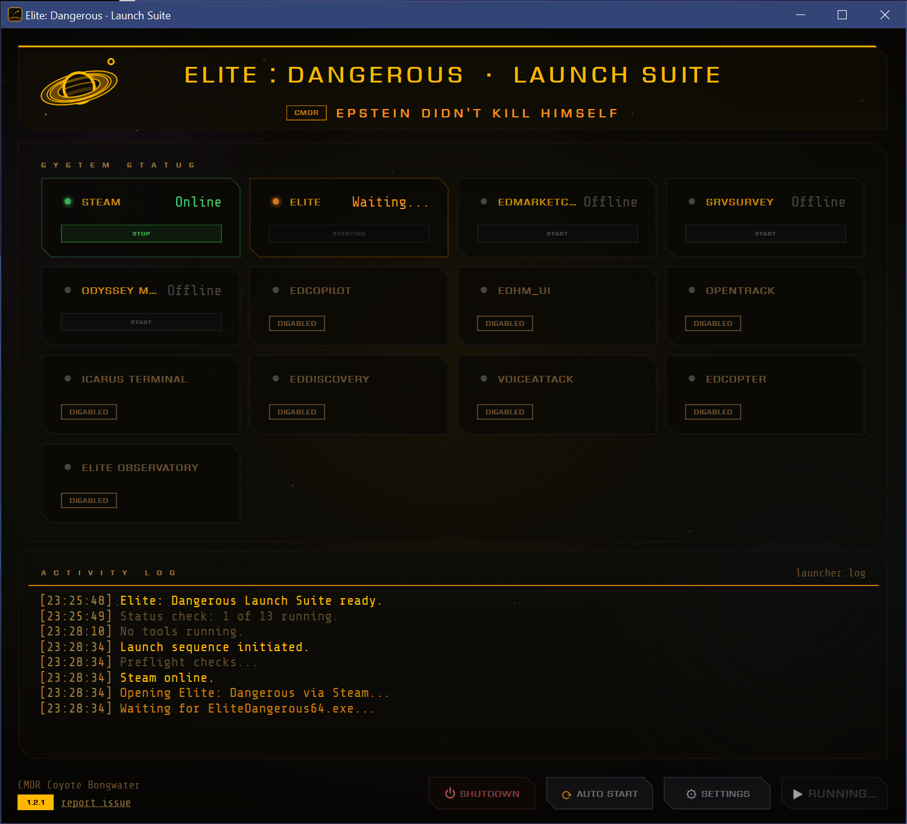
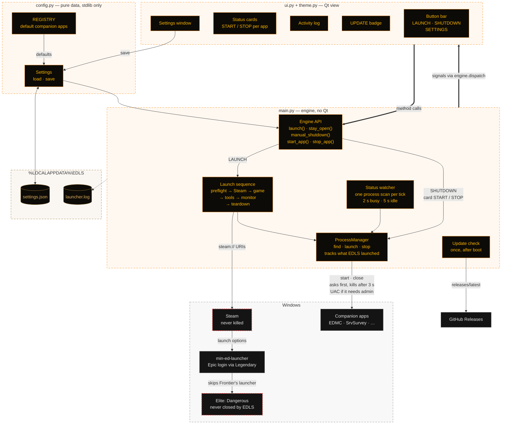

# EDLS — Elite: Dangerous Launch Suite
<p align="center">
  
</p>

EDLS is a Windows desktop launcher for [Elite: Dangerous](https://www.elitedangerous.com/).
It will find and boot Steam, then Elite via legendary and min-ed-launcher (see below), then up to a dozen companion apps of your choosing,
show a live HUD-style status board while you play, and shut itself and the rest of your companion apps down when Elite closes. Note that this does require a small amount of configuration on your end; if you skip setup for min-ed-launcher and legendary, EDLS will not actually save you much of any time or effort.

---

## Features

- **One-click launch** — Steam, Elite: Dangerous, and your desired programs all at once,
  bypassing Frontier's native launcher (see
  [Prerequisites](#prerequisites)).
- **Live status board** — a card per app showing Offline / Launching / Online
- **Automatic teardown** — when Elite exits, EDLS closes the companion tools for you, then itself. (adjustable)
- **Per-app start/stop** — bring a single tool up or down from its status card
- **Configurable** — add/remove/enable/disable apps and edit their paths in a
  built-in settings table. Add a commander name if you please. There's also a (WIP) light mode ui
- **Auto-start** — Off by default for easier setup. You should turn this on once you have EDLS configured to your liking, otherwise it's 2 clicks instead of 1

---

## Prerequisites


### 1. min-ed-launcher

[min-ed-launcher](https://github.com/rfvgyhn/min-ed-launcher) is a minimal,
fast replacement for the official Elite: Dangerous launcher. Rather than the clunky, slow, ugly, advertisement-ware launcher, the game will - get this - just f**king start. We will trick Steam into pointing to it with commandline arguments, then use an epic games store account to authenticate. The reason for this is that passing off our launcher as the epic store is the only way Frontier will permit us to skip their launcher.

- Download and install it from the
  [min-ed-launcher releases page](https://github.com/rfvgyhn/min-ed-launcher/releases).
- Follow its
  [setup guide](https://github.com/rfvgyhn/min-ed-launcher#setup) to register it
  as the launcher Steam uses for Elite: Dangerous (the project documents the
  Steam launch-option / `EDLaunch.exe` replacement steps for each account type).
- Confirm Elite starts correctly through min-ed-launcher on its own **before**
  bringing EDLS into the picture.

### 2. Legendary

[Legendary](https://github.com/derrod/legendary) is a command-line
Epic Games Store client. Min-ed-launcher uses Legendary to authenticate without needing the
full Epic Games launcher installed.

- Install Legendary per its
  [README](https://github.com/derrod/legendary#installation).
- Log in once with `legendary auth` so your Epic credentials are stored.
- Point min-ed-launcher at Legendary as described in min-ed-launcher's
  [Epic setup notes](https://github.com/rfvgyhn/min-ed-launcher#epic).


---

## Installation

Download EDLS-Setup-1.3.0.exe from the [Releases page](https://github.com/coyoteware/EDLS/releases/latest)

VirusTotal analysis: [https://www.virustotal.com/gui/file/a8224787b93396338ca297ad050cbf125035a88e9a8d8566ce481e4236892e98/detection](https://www.virustotal.com/gui/file/a8224787b93396338ca297ad050cbf125035a88e9a8d8566ce481e4236892e98/detection)

### Updates

Versions after 1.2.1 check GitHub for a new release at startup. If there is one,
an **update** badge appears next to your CMDR name. Click it for the steps and a
button to the release page: download the new installer there and run it. It installs
over your current version and keeps your settings. Turn the check off in Settings.

What's new: [release-notes.md](release-notes.md).

---

## Configuration

EDLS ships with default registry entries for these tools (each can be enabled,
disabled, or have its path edited). The ones it finds on your PC start out enabled:

|     |     |     |
| --- | --- | --- |
| EDMarketConnector | SrvSurvey | Odyssey Materials Helper |
| EDCoPilot | EDHM-UI | opentrack |
| ICARUS Terminal | EDDiscovery | VoiceAttack (1 or 2) |
| EDCoPTER | Elite Observatory | Elite Studio |
| EDDI | | |

>>*NOTE* on filepaths: The filepath for SrvSurvey is a diabolical beast. You are unlikely to be successful in entering it manually. If for whatever reason EDLS is unable to find its install automatically, please report it at the issues page.

>>*NOTE* on admin rights: some tools (EDHM-UI, on most accounts) ask Windows for administrator rights. EDLS itself never runs as administrator, so when it starts one of these, Windows shows its usual UAC prompt. If EDLS has to close one later, Windows asks once more (one prompt covers every such tool). Don't want the prompts? Turn off **Ask for admin rights when a tool needs them** in SETTINGS: EDLS then leaves those tools to you.

>>*NOTE* on EDDI: if you use EDDI through VoiceAttack (its EDDI plugin), leave EDDI unticked in SETTINGS and VoiceAttack ticked. The plugin starts EDDI for you and closes it with VoiceAttack. With both ticked, EDLS and the plugin can both try to start EDDI at once.


Open **SETTINGS** from the main window to **Add, remove, enable/disable** companion apps and edit each app's executable path. Paths support `%ENV%` variables (e.g. `%ProgramFiles%`).

Settings and the activity log are stored under:

```
%LOCALAPPDATA%\EDLS\settings.json
%LOCALAPPDATA%\EDLS\launcher.log
```
>>Yes I used Claude in making this. I have a degree in computer science which predates LLMs. If you try to lump me in with mouth breathing vibecoder scrubs I will personally escort a thargoid titan up your bunghole with priority overnight shipping. This being said, enjoy and please report any issues.

---

## Architecture

Three Python modules plus `theme.py`, and one hard rule: only the view imports Qt.
The view drives the engine with plain method calls; the engine answers with signals
that `engine.dispatch` hands to the GUI thread.



---

## Credits

- CMDR Coyote Bongwater
- Python 3.11, VScode, Claude Opus 5.5, InnoSetup
- The Elite: Dangerous community
- [min-ed-launcher](https://github.com/rfvgyhn/min-ed-launcher) by rfvgyhn and
  [Legendary](https://github.com/derrod/legendary) by derrod
## License

[MIT](LICENSE) © 2026

---

*Fly safe, CMDR. o7*
